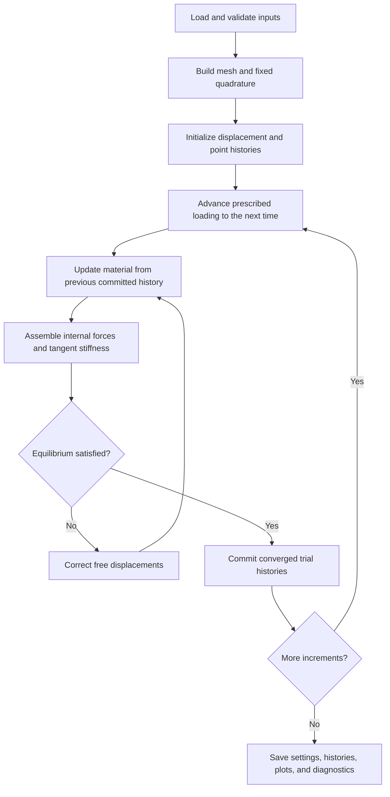

# CutCell Mechanics

**Verified immersed finite-element analysis with moment-fitted quadrature.**

[](https://github.com/Ashx120/cutcell-mechanics/actions/workflows/tests.yml)
[](pyproject.toml)
[](LICENSE)

[Quick start](#install-and-check) · [Editable settings](#edit-inputs-in-one-place) ·
[Results](docs/V3_RESULTS.md) · [Contributing](CONTRIBUTING.md) · [Changelog](CHANGELOG.md)

A Python research portfolio project for small-strain plane-stress analysis on a
Cartesian Q4 mesh with a circular hole. It combines verified elastic and J2
Perzyna viscoplastic solvers with quadtree and non-negative moment-fitted quadrature.

**This is an AI-assisted computational mechanics project.**

**V3 result on the tested plate:** moment fitting used **17% fewer physical history
points** and **18% fewer plane-stress updates**. The largest reaction-history
difference was **0.0031% of the quadtree peak force**. Saved individual runs showed
roughly **19–21% shorter solve time**. These observations belong to this experiment.


## Install and check

Use Python **3.11+**, Git, and a terminal. Recorded runs use Python 3.12 on Windows.
Run these PowerShell commands once:

```powershell
git clone https://github.com/Ashx120/cutcell-mechanics.git
cd cutcell-mechanics
# Until v3 is merged into main, select its branch.
git switch v3-viscoplasticity
python -m venv .venv
.\.venv\Scripts\python.exe -m pip install -e ".[dev]"
.\.venv\Scripts\python.exe -m pytest -q
```

The suite contains **38 tests**. Activation is optional because these commands
use the environment's Python explicitly. On Linux/macOS, substitute
`.venv/bin/python` for `.\.venv\Scripts\python.exe`. For recorded dependency
versions, install `requirements-lock.txt` before installing the package with
`--no-deps`. Existing users can keep their environment and rerun the editable
installation after updating package metadata. Run commands from the project root.

## Run v3

### Start with a small plate

```powershell
.\.venv\Scripts\python.exe playground.py
```

The example uses a 6 x 6 mesh, depth-two quadrature, and ten increments per phase.
Right-edge displacement increases to 0.012 mm over one second, then stays fixed
for one second. This coarse run supports learning and quick checks. Progress
messages report step, time, reaction, and sampled maximum strain. Finer runs can
take several minutes.

### Edit inputs in one place

Edit the settings block at the top of [playground.py](playground.py), save, and
rerun that same command. This is the primary v3 interface. It builds the model,
solves the full history, and saves plots and data using the shared solver.

| Settings | Meaning and units |
|---|---|
| `GEOMETRY` | `nx`, `ny`, dimensions, and origin-centred hole `radius` in mm |
| `MATERIAL` | Elastic, yield, hardening, and Perzyna parameters; stress in MPa and relaxation time in seconds |
| `THICKNESS` | Thickness in mm |
| `LOADING` | Peak displacement in mm, loading/hold durations in seconds, and increments per phase |
| `QUADRATURE` | `method`, subdivision `depth`, and fictitious stiffness `alpha` |
| `OUTPUT_DIR` | Folder for this run's data and plots |
| `OVERWRITE_OUTPUT` | Set `True` to replace an earlier run in that folder |

Set `radius=0` for a solid rectangle. A positive radius must be smaller than both
dimensions. The hole is centred at the origin in this quarter model. Left-edge
ux and bottom-edge uy are fixed by symmetry. Right-edge ux follows the loading
schedule while uy is free. The top and hole boundaries carry zero prescribed
traction. This boundary layout is fixed in the example. General nodal constraints
can be supplied through the Python `solve_increment` interface.

Default outputs go to `results/playground/v3/`. To keep earlier results, change
`OUTPUT_DIR` before another run. The original elastic playground is preserved
at `scripts/elastic_playground.py`. The material-point demonstration has its
own shear-loading settings in `scripts/material_point.py`.

For reproducible command-line experiments, `scripts/nonlinear_plate.py` also
accepts [a JSON input](examples/nonlinear_plate.json) through `--config`. Those
advanced commands are shown below. Editing `playground.py` is sufficient for
normal interactive use.

### Reproduce the finer comparison

These commands keep geometry, material, mesh, and loading matched:

```powershell
.\.venv\Scripts\python.exe scripts/nonlinear_plate.py --config examples/nonlinear_plate.json --mesh 16 --depth 3 --steps 40 --method quadtree --output results/walkthrough/v3-quadtree
.\.venv\Scripts\python.exe scripts/nonlinear_plate.py --config examples/nonlinear_plate.json --mesh 16 --depth 3 --steps 40 --method moment-fitting --output results/walkthrough/v3-fitted
.\.venv\Scripts\python.exe scripts/compare_nonlinear_histories.py
```

`--mesh` overrides both nx and ny. `--steps` overrides increments per phase.
`--alpha` overrides fictitious stiffness. Use `--help` for the full interface.
Reusing a nonempty analysis folder requires `--overwrite`; a new output folder
keeps previous runs available. Commands without `--config` retain their original
default model.

### Read the outputs

| File | Contents |
|---|---|
| `settings.json` | Resolved inputs including overrides; reusable with `--config` |
| `metrics.json` | Parameters, point counts, update counts, and timing metadata |
| `history.csv` | Time, displacement, reaction, maximum strain, iterations, residuals |
| `response.png` | Reaction versus time and imposed displacement |
| `plastic_strain.csv` | Final physical-point coordinates and accumulated strain |
| `plastic_strain.png` | Unsmoothed strain samples at the integration points |

The comparison checks matched inputs and time samples, then saves an overlay,
signed force differences, and summary metrics. It accepts original v3 snapshots
and newly configured runs. Inspect published data without rerunning:

```powershell
.\.venv\Scripts\python.exe scripts/compare_nonlinear_histories.py --reference results/v3/quadtree --fitted results/v3/fitted --output results/walkthrough/saved-comparison
```

`results/v3/` contains published snapshots. `results/walkthrough/` and
`results/playground/` are ignored local experiments. Top-level `results/` files
preserve the original elastic benchmark.

## Follow the verification checkpoints

Run each script using the environment's Python executable.

| Script | Purpose |
|---|---|
| `scripts/material_point.py` | Shear loading, relaxation, and unloading |
| `scripts/material_point.py --dt 0.005 --output results/walkthrough/point-finer` | Time-step sensitivity |
| `scripts/material_point.py --dt 0.0025 --loading-time 0.5 --output results/walkthrough/point-fast` | Faster loading to the same peak strain |
| `scripts/check_material_tangent.py` | 3D tangent against numerical differentiation |
| `scripts/check_plane_stress.py` | Zero thickness stress and in-plane tangent |
| `scripts/nonlinear_rectangle.py` | Uniform FEM response against a material point |
| `scripts/nonlinear_plate.py` | Spatially varying yielding and reaction relaxation |
| `scripts/compare_nonlinear_histories.py` | Quadrature agreement over the history |

[V3_RESULTS.md](docs/V3_RESULTS.md) contains equations, sensitivity tables,
recorded timing context, and remaining limits. Its saved verification data still
applies after these input/workflow improvements.

## Earlier elastic and quadrature experiments

V1 established the elastic solver and Kirsch verification. V2 added moment
fitting and cached-integration experiments. Both remain runnable:

```powershell
.\.venv\Scripts\python.exe scripts/elastic_playground.py
.\.venv\Scripts\python.exe scripts/run_benchmark.py --output results/walkthrough/elastic
.\.venv\Scripts\python.exe scripts/fit_one_cell.py --degree 2
.\.venv\Scripts\python.exe scripts/compare_quadrature.py
.\.venv\Scripts\python.exe scripts/time_quadrature.py
```

Edit `scripts/elastic_playground.py` for custom linear-elastic geometry, material, and edge
conditions. [LINEAR_RESULTS.md](docs/LINEAR_RESULTS.md) preserves the formulation,
reference model, convergence tables, and v2 timings.

## Calculation flow



Physical points evolve viscoplastically. Fictitious points inside the hole supply
weak elastic stiffness. Fitting compresses each region separately before loading;
point identities stay fixed throughout a run.

## File guide

| Location | Responsibility |
|---|---|
| `playground.py` | Primary v3 entry point and editable settings |
| `examples/nonlinear_plate.json` | Optional inputs for command-line experiments |
| `scripts/elastic_playground.py` | Original v1/v2 elastic playground |
| `scripts/` | Analyses, comparisons, and verification demonstrations |
| `src/immersed_elasticity/plate_settings.py` | Input defaults, validation, saved-run compatibility |
| `nonlinear_solver.py` in the source package | Incremental equilibrium and history |
| `viscoplasticity.py`, `plane_stress.py` | Material update, tangent, plane stress |
| `solver.py`, `quadrature.py`, `moment_fitting.py` | Q4 mechanics and integration |
| `reference.py`, `benchmark.py` | Kirsch solution and elastic verification |
| `tests/` | Physical, numerical, and script-workflow checks |
| `docs/` | Detailed reports and roadmap |
| `results/v3/` | Recorded nonlinear data and figures |

## Troubleshooting

- If imports fail, use the environment's Python and rerun `pip install -e ".[dev]"`.
- For a nonempty output folder, choose a new folder or explicitly use `--overwrite`.
- For configuration errors, check the reported field and units. Unknown keys are
  rejected to catch misspellings.
- A comparison requires matching geometry, material, loading, time steps, alpha,
  and reference depth.
- If Newton fails, history stays uncommitted. Try smaller increments or a less
  demanding loading history. The solver raises an exception on failed convergence.

## Scope and limitations

Inspired by Schmäke, Wege, and Ruess, *Efficient Thermo-Viscoplastic Analysis Using
a Multi-Level hp-Finite Cell Method with Non-Negative Moment Fitting*.
[Source paper](https://arxiv.org/abs/2604.15921v2)

This project independently implements selected immersed-discretization,
integration, and isothermal material ideas. Parameters are illustrative. Thermal
coupling, high-order bases, and hierarchical adaptive overlays remain extensions.
The paper's Section 5.1 uses a different Perić flow rule.

The nonlinear solver uses fixed increments and plain Newton iterations, with no
line search or automatic time-step reduction. Changing meshes or quadrature
requires a fresh history. Local strain maxima remain incompletely converged.
Runtime observations are individual runs, and history counts represent point
counts rather than measured memory bytes. Nonlinear quadrature agreement is
specific to the tested load path and resolution.

See [the v3 report](docs/V3_RESULTS.md) and
[development roadmap](docs/V2_ROADMAP.md) for further verification work.

## License

Code and documentation use the [MIT License](LICENSE). Dependencies and the
referenced paper retain their respective licenses.

## Contributing and citing

For bugs, include the input settings, exact command, output, environment, and
commit used. Numerical feature proposals should include a verification strategy.
See [CONTRIBUTING.md](CONTRIBUTING.md) and the
[issue templates](https://github.com/Ashx120/cutcell-mechanics/issues/new/choose).

[CITATION.cff](CITATION.cff) provides software attribution. Cite the specific Git
commit for reproducible use, and cite the source paper separately when discussing
its method. The [changelog](CHANGELOG.md) tracks development milestones.

The [publishing checklist](docs/PUBLISHING.md) covers the remaining GitHub release
steps and distinguishes local checks from CI checks on the remote repository.
