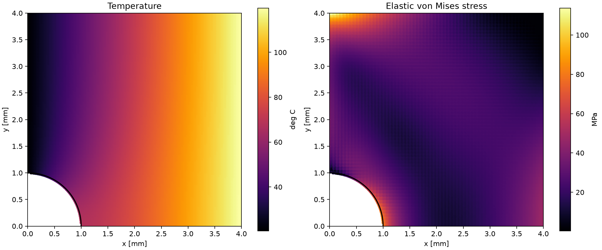

# CutCell Mechanics

**Thermal expansion, viscoplasticity, and moment-fitted integration in Python.**

[](https://github.com/Ashx120/cutcell-mechanics/actions/workflows/tests.yml)
[](pyproject.toml)
[](LICENSE)

[Start here](docs/GETTING_STARTED.md) · [Results](docs/RESULTS.md) · [Model and limits](docs/MODEL.md) · [Technical guide](docs/DEVELOPMENT.md)

CutCell Mechanics models how a thin plate with a hole expands and develops
stress under heating. It uses a Cartesian finite-element mesh and compares
quadtree integration with non-negative moment fitting. The examples cover
elastic response, plastic deformation, and stress relaxation during a temperature hold.

**This is an AI-assisted computational mechanics project.**



64 x 64 thermoelastic example: left edge 20 C, right edge 120 C, with left-x
and bottom-y rollers. This figure uses constant properties and an elastic model.
The nonlinear quadrature comparison below is a separate 16 x 16 case. The
starter is coarser, and local stress peaks have not been established as mesh converged.

## Run your first example

Use Python **3.11+** and Git. In Windows PowerShell:

```powershell
git clone https://github.com/Ashx120/cutcell-mechanics.git
cd cutcell-mechanics
python -m venv .venv
.\.venv\Scripts\python.exe -m pip install -e ".[dev]"
.\.venv\Scripts\python.exe run.py
```

On Linux/macOS replace `.\.venv\Scripts\python.exe` with `.venv/bin/python`.
Existing users can rerun the install command after updating.

The coarse starter took about **12 seconds** on the development machine;
runtime varies. Progress appears in the terminal, followed by the output path.
Each run gets a new folder under `results/runs/`, preserving earlier results.

Open **summary.txt**, **history.png**, and **fields.png** in that folder. The
[first-run guide](docs/GETTING_STARTED.md) explains what the plots mean and how
to recognise the difference between numerical agreement and physical accuracy.

## Change the experiment

Edit **[config.py](config.py)**, save, and run the same command again.

Set `MODE = "thermal"` for heating or `MODE = "displacement"` for the tensile
load-and-hold example. Both use the same geometry, material, and quadrature settings.
The two former root playgrounds have been merged into this file.

| Settings | What you control |
|---|---|
| `MODE` | Thermal or displacement-controlled loading |
| `GEOMETRY` | Plate dimensions, hole radius, and mesh resolution |
| `MATERIAL`, `PROPERTIES` | Elastic/plastic parameters and selected temperature-dependent fits |
| `THERMAL_LOADING` | Reservoir temperatures, heating duration, hold, and time steps |
| `DISPLACEMENT_LOADING` | Right-edge displacement, loading/hold durations, and increments |
| `SUPPORTS` | Restrained edges or only whole-body motion prevention |
| `QUADRATURE` | Quadtree or moment fitting, integration depth, fictitious factor |
| `THICKNESS`, `CONDUCTIVITY`, `EXPANSION_COEFFICIENT` | Thickness and thermal parameters |
| `OUTPUT_ROOT` | Parent folder for new runs |

All units and options are explained in the file. Geometry is in mm, stress in
MPa, time in seconds, and temperature in degrees C. Boundary layouts are the two
documented choices, not an arbitrary boundary-condition editor. Paper property
modes override the corresponding elastic/hardening constants, as documented.

## What the recorded comparison shows

In the matched **16 x 16 restrained thermal example**, moment fitting uses:

- **33.5% fewer total mechanical integration points:** 1628 -> 1082.
- **17.0% fewer physical history points:** 1227 -> 1019.
- A largest mean-right-displacement history difference of **2.15e-9 mm**.

The nodal temperature fields are identical in this comparison. These observations
belong to this input set; they do not establish local-field convergence or a
general performance guarantee. [Saved data and reproduction commands](docs/RESULTS.md)
are included, so you can inspect the evidence without another nonlinear solve.

## Scope

This is a **paper-inspired implementation of selected methods**, not a full
replication. It uses 2D small-strain plane stress, immersed Q4 elements, Perzyna
viscoplasticity, stationary one-way thermal coupling, and selected elastic and
hardening fits. The initial yield and viscosity remain fixed.

Higher-order adaptive overlays, the paper's matched 3D examples, and missing
temperature-property laws are outside this release. No transient conduction or
plastic heating is implemented; the source paper also neglects those effects.
Supports strongly affect the demonstrated plastic hotspot. Read
[the model and limitations](docs/MODEL.md) before interpreting engineering results.

Inspired by Schmäke, Wege, and Ruess, *Efficient Thermo-Viscoplastic Analysis Using
a Multi-Level hp-Finite Cell Method with Non-Negative Moment Fitting*,
[arXiv:2604.15921v2](https://arxiv.org/abs/2604.15921v2).

## Verification and project guide

```powershell
.\.venv\Scripts\python.exe -m pytest -q
```

The checks cover analytical elastic/thermal limits, material tangents, history
management, equilibrium, quadrature, and the user workflow. GitHub CI tests
Windows/Linux on Python 3.11/3.12 and builds/imports the package wheel.

Reusable numerical code is under `src/immersed_elasticity/`, experiment runners
under `scripts/`, checks under `tests/`, and explanations under `docs/`. Older
checkpoint scripts remain available. [The technical guide](docs/DEVELOPMENT.md)
maps the files and preserved milestones; new users can start with run.py alone.

Code and documentation use the [MIT License](LICENSE). The referenced paper
and dependencies retain their own licences. See [CONTRIBUTING.md](CONTRIBUTING.md),
[CITATION.cff](CITATION.cff), and [the changelog](CHANGELOG.md). Cite the specific
software commit and the source paper separately when discussing its method.
