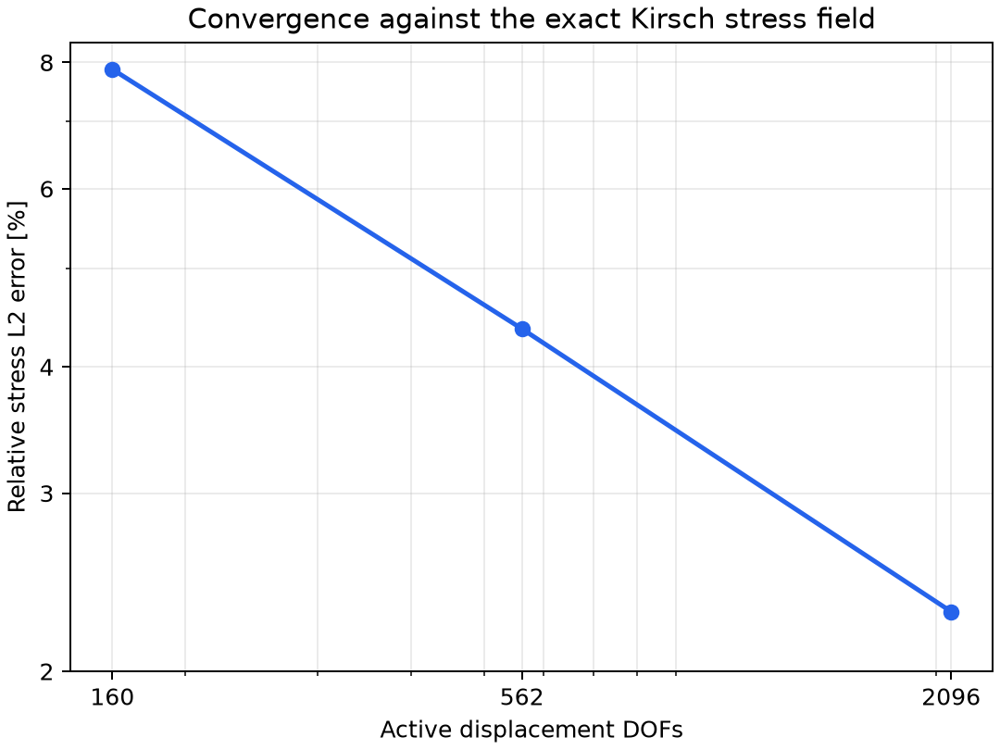

# Linear-elastic verification and quadrature experiments

See the [main README](../README.md) for installation and run commands.

## Engineering model


The physical quarter-domain is `[0,4] x [0,4] mm` outside a hole of radius `1 mm`
at the origin. Material parameters are `E = 210000 MPa`, `nu = 0.3`, and thickness
`t = 1 mm`. Remote tension in the analytical solution is `100 MPa` in the x direction.

- Symmetry: `ux = 0` on `x = 0`; `uy = 0` on `y = 0`.
- Outer loading: `traction = sigma_Kirsch . normal` on the top and right edges.
- Hole: traction-free in the physical problem, approximated through a soft
  fictitious extension in the discrete formulation.

**Why exact outer tractions?** Kirsch describes an infinite plate. Applying its
analytical traction field to the truncated square makes the same stress field
an exact reference for this finite domain. Uniform outer traction would introduce
a finite-width difference, so the factor of three would not be an exact reference
for that different boundary-value problem.

### Formulation

Engineering strain is `[epsilon_xx, epsilon_yy, gamma_xy]`. The plane-stress
constitutive matrix is

```text
         E       [ 1    nu       0       ]
D = ---------- * [ nu   1        0       ]
     1 - nu^2    [ 0    0    (1 - nu)/2 ]

K_e = thickness * integral( alpha(x) * B^T D B ) dA
```

The indicator is `1` in material and `1e-6` in the fictitious part of active cut
cells. Fully fictitious cells and unused nodes are removed. Interface boxes
subdivide recursively; uncut boxes use a 2x2 Gauss rule. Terminal cut boxes sample
the indicator at Gauss points. This is approximate geometry integration, not an
exact boundary representation. The default maximum subdivision depth is four.

Prescribed displacement DOFs are eliminated exactly. Reactions are recovered
from the original system as `K u - f`. Element strains and stresses are evaluated
directly from the Q4 displacement field. The field figure uses unsmoothed interior
sample values; these plotting samples are not the assembly quadrature points.

## Verification and results

Run `python -m pytest -q` in the configured environment. Thirty-eight tests currently
pass, including the v3 constitutive, tangent, plane-stress, and incremental-solver
checks described in [the v3 results](V3_RESULTS.md), plus moment preservation,
compressed Q4 stiffness, same-mesh solution
agreement, and the fallback from a failed fit. Three parameterized checks reject
invalid material properties.

| Check | Acceptance criterion |
|---|---|
| Affine displacement patch | Displacements and constant strain reproduced to floating-point tolerance |
| Rectangular uniaxial tension | Exact axial extension and Poisson contraction |
| Load and reaction balance | Global equilibrium within stated test tolerances |
| Cut-domain quadrature | Positive weights and quarter-circle area accuracy |
| Analytical hole boundary | Zero Kirsch traction and expected analytical peak stress |
| Immersed stress convergence | Error decreases from 8x8 to 16x16; finer error below 15% |

The analytical peak test checks the reference implementation. The hotspot study
below compares the computed stress with that reference at the same location.

### Mesh convergence

Default depth = 4, fictitious stiffness factor = `1e-6`:

| Background grid | Active cells | Displacement DOFs | Relative stress L2 error |
|---|---:|---:|---:|
| 8 x 8 | 63 | 160 | 7.877% |
| 16 x 16 | 248 | 562 | 4.362% |
| 32 x 32 | 983 | 2096 | 2.291% |



The error is `||sigma_h - sigma_exact||_L2 / ||sigma_exact||_L2` over the physical
domain, with the full tensor Frobenius norm (`sigma_xx^2 + sigma_yy^2 + 2*tau_xy^2`).
It is not an energy norm. Evaluation uses separate depth-six quadrature with a
3x3 Gaussian rule; its geometry integration is also approximate. An analytical
area comparison is recorded to expose that approximation.

Normalized free-DOF residuals are below `1e-12` for these meshes. Small residuals
confirm the algebraic solve, not the discretization accuracy; the stress errors
above quantify the latter.

### Stress at the analytical hotspot

Kirsch gives a tangential stress of 300 MPa at `(x, y) = (0, 1) mm`, where the
tangent to the hole is horizontal. For each mesh, we evaluated `sigma_xx` at
that point using the Q4 strain-displacement matrix and nodal displacements of
the element immediately above and to the right. This gives a one-sided value
from the material side with no nodal stress averaging. All runs used quadrature
depth 4 and a fictitious stiffness factor of `1e-6`.

| Background grid | Computed stress (MPa) | Absolute relative error |
|---|---:|---:|
| 8 x 8 | — | 23.58% |
| 16 x 16 | — | 6.06% |
| 32 x 32 | 299.54 | 0.15% |
| 64 x 64 | 301.92 | 0.64% |

Both fine meshes were within 1% of the reference at this point. The signed
error changed from -0.46 MPa to +1.92 MPa, so the pointwise error did not decrease
monotonically. These values describe stress at the analytical hotspot. Finding
the numerical peak would require sampling along the hole boundary.

### Sensitivity at 16 x 16

| Parameter varied | Values | Relative stress L2 errors |
|---|---|---|
| Fictitious stiffness factor, depth 4 | 1e-4 / 1e-6 / 1e-8 | 4.3620% / 4.3619% / 4.3619% |
| Quadrature depth, factor 1e-6 | 2 / 4 / 6 | 4.3911% / 4.3619% / 4.3616% |

For this mesh and geometry, mesh resolution dominates those parameter changes.
This is not a general conditioning guarantee for arbitrarily small cut fractions.

### V2 accuracy and integration-point comparison

Both methods use identical meshes, boundary conditions, reference quadrature
depth 4, and fictitious stiffness factor `1e-6`.

| Mesh | Quadtree points | Fitted points | Point reduction | Stress L2 error, both methods |
|---|---:|---:|---:|---:|
| 8 x 8 | 924 | 267 | 71.1% | 7.877% |
| 16 x 16 | 2,384 | 1,027 | 56.9% | 4.362% |
| 32 x 32 | 6,764 | 4,007 | 40.8% | 2.291% |

Only cut cells are compressed. Solid cells retain standard Gauss quadrature.
The fraction of work in solid cells increases with refinement in this example.
On the 16 x 16 mesh, relative differences between methods were `2.917e-17` for
global stiffness, `9.551e-16` for displacement, and `1.488e-15` for constrained-DOF
reactions. Reproduce this comparison with `scripts/compare_quadrature.py`.

### V2 setup and cached-rule timing experiment

The following Windows measurements were recorded during the walkthrough using
`scripts/time_quadrature.py`, with five trials and twenty integration passes per
trial. Each reported time is a median. Repeated passes recompute the Q4 kinematics
and element stiffness using stored points and weights.

| Method | Rule setup | One integration pass across the mesh |
|---|---:|---:|
| Quadtree | 0.029940 s | 0.018614 s |
| Moment fitting | 0.032281 s | 0.012897 s |

In this run, fitting added 0.002341 s of setup and saved 0.005717 s per pass.
Estimated setup plus twenty passes was 0.402220 s for quadtree and 0.290221 s
for moment fitting, approximately 28% less time for this measured workload.
The estimated first cheaper pass count was one. Timings and break-even estimates
vary with machine and run conditions.

This experiment excludes sparse global assembly, the linear solve, and material
history updates. A separate single-run full assembly measurement was slightly
slower with fitting (0.0652 s versus 0.0623 s). The measurements cover different
workloads and timing conditions. A linear-elastic application would normally
reuse its assembled stiffness matrix. The cached-rule experiment isolates a
cost relevant to future nonlinear analyses that repeatedly update stiffness.

### Scope of the paper reproduction

V2 compresses the reference quadtree rule using its existing positive-weight
points as candidates. This guarantees a feasible candidate rule before fitting,
subject to numerical solution tolerances. The paper also investigates candidate
point enrichment. This implementation uses fixed candidates and a quadtree
fallback on a failed fit. The fit tolerance is a relative moment residual of
`1e-10`. Geometry accuracy is controlled by the prescribed quadtree depth rather
than an automatically enforced integration-error tolerance.

Degree two in each coordinate covers the stiffness integrand for our rectangular
Q4 elements with constant elastic properties. That exact polynomial argument
needs reassessment for variable properties, nonlinear constitutive models, or
other element mappings. Fictitious-region weights are included in full-solver
fits. The physical-area demonstration instead uses `alpha=0`.
