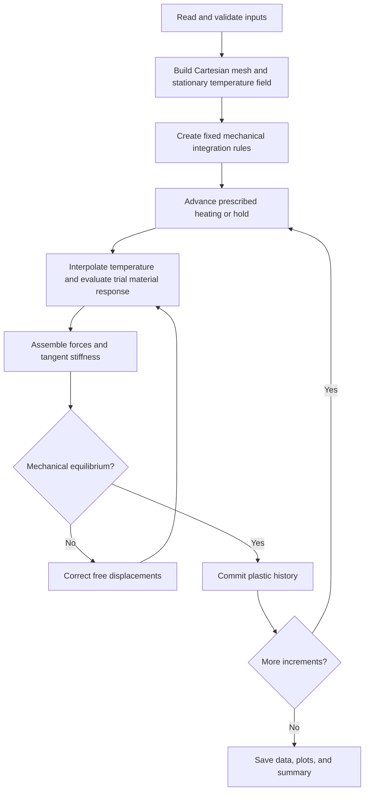

# What the model represents

This is a paper-inspired research portfolio implementation of selected immersed
finite-element and quadrature ideas, not a complete replication or a design
certification tool. It is independently implemented in Python and NumPy/SciPy.

## Numerical pipeline

**FEM** approximates displacement and temperature with shape functions on small
elements. Here those elements form a Cartesian grid. An **immersed** method
represents the curved hole inside that grid rather than fitting element edges
to it. Integration distinguishes physical material from fictitious material.

**Quadtree integration** subdivides cut cells to approximate integrals around the
hole. **Moment fitting** finds a sparse non-negative set of weights that preserves
selected polynomial integrals from that reference rule. It reduces mechanical
integration work; it does not refine the displacement mesh. Reference integration
and its geometry error still matter. Physical and fictitious regions are fitted
separately, and failed fits fall back to quadtree.

## Mechanics and heat

- Small-strain, two-dimensional Cartesian Q4 elements, with plane stress.
  Thickness stress is eliminated by a local constitutive solve.
- J2 Perzyna viscoplasticity with exponential saturation hardening, implicit
  backward Euler, and a consistent material tangent.
- Previous converged plastic history is fixed during Newton iterations. Only a
  converged increment is committed. Changing the mesh/rule requires a fresh run.
- Stationary conduction with constant conductivity; a prescribed ramp scales
  the final equilibrium field from the initial uniform reference temperature.
- One-way temperature-to-mechanics coupling. Isotropic thermal strain is
  subtracted from total strain. Thermal expansion is constant.
- The fictitious region has alpha-scaled conductivity and elastic stiffness;
  it has no thermal eigenstrain or plastic flow. The insulated-hole limit is
  approximated, rather than imposed on a fitted curved boundary.

## Material options and units

`constant` uses the corresponding inputs from MATERIAL. `paper-reference` uses
the paper fit frozen at 20 C. `paper-temperature` evaluates the fit at the local
physical-point temperature. Temperature stays fixed in each global Newton solve.

The elastic fits specify bulk and shear moduli, converted to E and nu. The
hardening fits replace Q and b in `sigma_y = sigma_y0 + Q(T)*(1-exp(-b*p))`.
Initial yield and viscosity stay fixed; property modes do not automatically
reproduce a calibrated alloy. Their plotted fit range is restricted in the code
to 0-1500 C, which is not a claim of validation over that whole range.
See [property provenance and reference checks](V4_MATERIAL_PROPERTIES.md).

Use mm, N, MPa, seconds, and degrees C. Temperature differences are in K.
Conductivity is W/(mm K), heat input W, and heat flux W/mm². The initial/reference
temperature is stress free; reservoir targets are absolute temperatures.

## Physical interpretation and verification limits

Edge rollers can produce high thermal stresses by restraining deformation. The
minimal-support alternative removes only rigid motion and represents a different
physical body/boundary setup. In our recorded comparison, releasing edge rollers
reduces the elastic peak from 329.10 to 26.20 MPa. The nonlinear corner hotspot is
therefore strongly restraint driven. Its local magnitude is not established as
mesh converged. Coarse demos can even place the largest sampled plastic strain
near a different part of the boundary.

A small equilibrium residual confirms the discretised force balance. It does not
establish geometric accuracy, convergence, or agreement with experiment.
Two quadrature rules can agree while sharing the same discretisation error.
Sampled stress/strain maxima from different point sets are not field-error norms.
Individual runtime measurements are not repeated performance benchmarks; point
counts are not measured memory bytes.

## Relationship to the source paper

Schmäke, Wege, and Ruess, *Efficient Thermo-Viscoplastic Analysis Using a
Multi-Level hp-Finite Cell Method with Non-Negative Moment Fitting*,
[arXiv:2604.15921v2](https://arxiv.org/abs/2604.15921v2).

Implemented components include immersed cut integration, non-negative fitting,
history-dependent plasticity, and stationary one-way thermal coupling.
Major omissions are higher-order bases, hierarchical overlay refinement,
gradient-jump-driven adaptivity, candidate-point enrichment, the matched Perić
hole benchmark, and the three-dimensional porous-plate application. Initial-yield,
thermal-expansion, and conductivity temperature fits are not fully implemented.
Our geometry, loading, and demonstration parameters differ from the paper's
numerical examples; no full-replication claim is made.

The paper itself also uses stationary conduction and neglects plastic heating.
Transient conduction and plastic heating would be extensions beyond that scope.
The paper avoids history transfer between adaptive meshes by restarting the full
loading history after each refinement cycle; we do not implement those cycles.

Plain Newton has no line search or adaptive time-step reduction. This release
adds no new physics beyond the v4 baseline. It packages and explains the selected
methods and their verification evidence.
