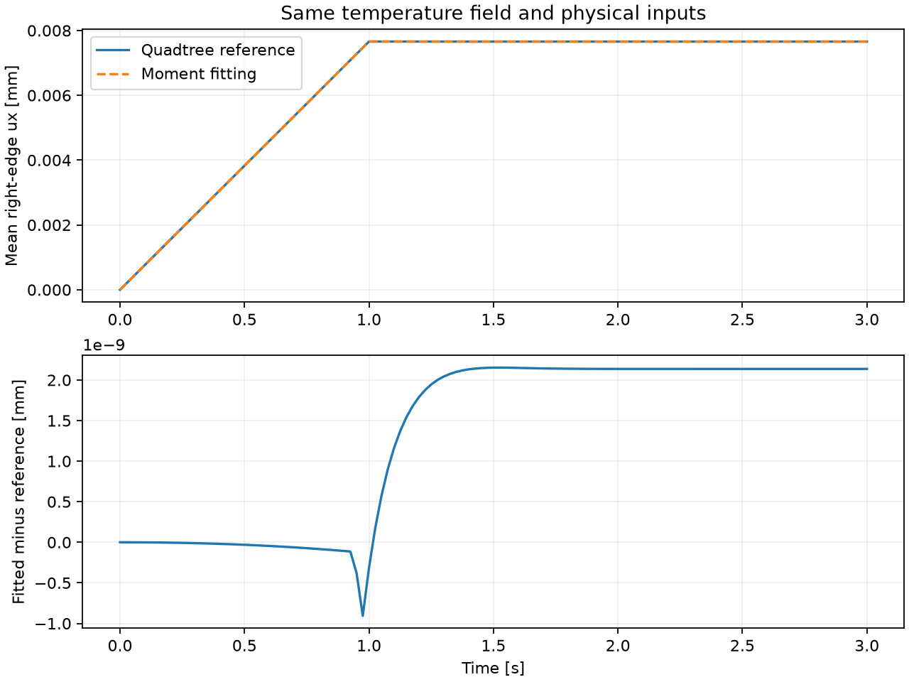
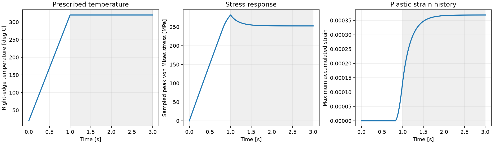
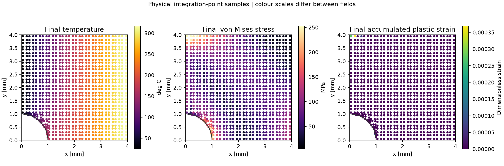

# Results and verification

The headline result is **close mechanical agreement with fewer integration
points** in a recorded restrained-heating example. This is a numerical comparison,
not experimental validation or a claim of full paper replication.

## Recorded thermal comparison

Geometry: 4 x 4 mm, hole radius 1 mm, thickness 1 mm. Mesh: 16 x 16,
quadtree depth 3, fictitious factor 1e-6. Right edge heats 20 -> 320 C over 1 s,
then holds to 3 s; left stays at 20 C. Left-x and bottom-y rollers restrain
deformation. Both runs use local-temperature elastic/hardening fits with fixed
250 MPa initial yield, fixed viscosity, and dt=0.025 s.

| Quantity | Quadtree mechanics | Moment-fitted mechanics |
|---|---:|---:|
| Total integration points | 1628 | 1082 |
| Physical history points | 1227 | 1019 |
| Sampled peak stress at 3 s [MPa] | 252.658292 | 252.658301 |
| Maximum accumulated strain at 3 s | 0.00036872 | 0.00036872 |

Moment fitting uses **33.5% fewer total integration points** and **17.0% fewer
physical history points**. Heat always uses quadtree, so both runs have identical
nodal temperature fields. Across shared times, the largest difference in mean
right-edge displacement is **2.15e-9 mm**. The relative final nodal displacement
norm difference across active nodes is **1.66e-5**.



The peak-stress history difference is at most 0.000350191 MPa, but those maxima
can use different sample locations; that is not a matched-point stress-field
error norm. Fewer history points do not directly measure memory bytes. Runtime
varies by machine and run; this release makes no repeated speedup-benchmark claim.

The saved [settings/data](../results/reference/thermal/) and
[provenance](../results/reference/thermal/provenance.json) are included. Regenerate
the comparison without running a nonlinear solve:

```powershell
.\.venv\Scripts\python.exe scripts/compare_thermal_runs.py
```

It writes comparison.json and comparison.png to `results/runs/comparison/`.
For a repeated comparison choose another `--output` or add `--overwrite`.

To rerun the recorded solves with the final entry point:

```powershell
.\.venv\Scripts\python.exe run.py --config results/reference/thermal/quadtree/settings.json
.\.venv\Scripts\python.exe run.py --config results/reference/thermal/fitted/settings.json
```

Each solve creates a new output folder. Expect roughly one to two minutes per
run on the development machine. These finer runs differ from the coarse starter
configuration in config.py; do not compare their maxima as if inputs were equal.

## Interpret the example



During heating, stresses rise and plastic flow begins locally. During the hold,
plastic strain continues accumulating while peak stress decreases. Because yield
and viscosity remain fixed, the final stress stays near the current hardening-
adjusted yield level rather than following the temperature drop of elastic moduli.



The largest recorded plastic strain occurs near the cold supported corner at
about 35.6 C. It is strongly restraint driven. Releasing edge rollers in the
elastic 32 x 32 comparison reduces the peak from 329.10 to 26.20 MPa with the
same temperature field. The hotspot is not a prediction for a freely expanding
plate, and its magnitude has not been established as mesh converged.

## What was checked?

| Check | Evidence |
|---|---|
| Elastic mechanics | Patch/uniaxial tests, Kirsch comparison, equilibrium |
| Material update | Loading/hold/unloading, rate effects, time sensitivity |
| Tangent operators | Numerical differentiation and plane-stress condensation |
| Thermal conduction | Exact rectangle temperature/flux, reservoir balance |
| Thermal expansion | Free expansion and analytical restrained stress |
| Thermal plasticity | Rectangle FEM against a material-point history |
| Plate sensitivity | Mesh, quadrature depth, fictitious factor, time step, and supports |
| Moment fitting | Polynomial moments, rule positivity/fallback, nodal/history agreement |
| User workflow | Validated inputs, independent runs, saved-input replay, output protection |

Run the full automated suite:

```powershell
.\.venv\Scripts\python.exe -m pytest -q
```

Detailed records remain in [linear results](LINEAR_RESULTS.md),
[isothermal nonlinear results](V3_RESULTS.md), and [thermal results](V4_RESULTS.md).
Those reports describe their own input sets. The constant-property time study
does not establish time convergence for every temperature-dependent case.

## What the evidence does not establish

Global equilibrium and quadrature agreement do not establish an exact solution,
local-field convergence, or experimental validation. Nonlinear mesh convergence,
independent local-field validation, and repeated runtime/memory benchmarks remain
open. See [MODEL.md](MODEL.md) for the complete scope and the differences from
the paper. These are declared limits of this portfolio release.
