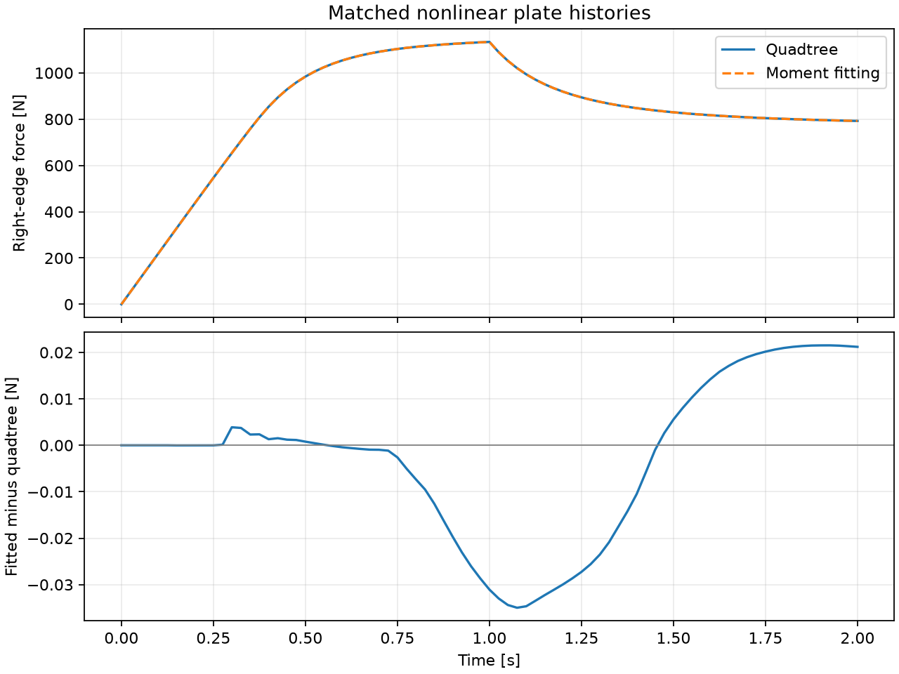

# V3 — isothermal viscoplasticity

V3 implements small-strain J2 Perzyna viscoplasticity with saturation hardening,
backward-Euler time integration, an analytical algorithmic tangent, and a local
plane-stress solve. Integration-point history is committed after global Newton
equilibrium converges. Failed increments leave the previous history intact.

This is an independent implementation of selected mechanical and integration
ideas from [Schmäke, Wege, and Ruess](https://arxiv.org/abs/2604.15921v2).
The model is isothermal and uses illustrative parameters. The paper includes
temperature-dependent properties, thermal coupling, high-order finite cells,
and adaptive overlay refinement. Its Section 5.1 also uses a different Perić flow
rule. Our plate results are an internal verification and quadrature comparison.

## Model and loading

The quarter-domain is a 4 mm square outside a circular hole of radius 1 mm at
the origin, with thickness 1 mm. Symmetry imposes ux=0 along x=0 and uy=0 along
y=0. The right-edge horizontal displacement increases to 0.012 mm over one
second and stays fixed for a further second. The right edge is free vertically;
the top and circular boundaries carry zero prescribed traction.

The material uses E=210000 MPa, nu=0.3, initial yield stress 250 MPa, saturation
increment Q=100 MPa, hardening rate b=20, relaxation parameter mu=100 s, and rate
exponent m=1. With accumulated equivalent viscoplastic strain p,

```text
sigma_y(p) = 250 + 100 * (1 - exp(-20*p))        [MPa]
dp/dt = (1/mu) * max(sigma_eq/sigma_y - 1, 0)^(1/m)
```

The stored plastic strain tensor uses tensor shear components. The FEM interface
uses engineering shear strain. The plane-stress wrapper solves sigma_zz=0 and
condenses the 3D tangent to the in-plane components. Every material evaluation
within a global increment starts from that increment's previous committed state.

Physical integration points evolve viscoplastically. Fictitious points remain
linear elastic with alpha-scaled weights. For nonlinear moment fitting, each
cut cell's physical and fictitious rules are compressed separately with degree
two per coordinate. Rules and their point identities remain fixed throughout
the loading history. Each method starts from a fresh unloaded state.

## Reproduce the checkpoints

Run these commands from the repository root in the configured environment.
The material-point example prescribes simple shear, with a one-second ramp,
two-second hold, and one-second return to zero strain.

```powershell
.\.venv\Scripts\python.exe scripts/material_point.py
.\.venv\Scripts\python.exe scripts/material_point.py --dt 0.005 --output results/walkthrough/v3-point-finer
.\.venv\Scripts\python.exe scripts/material_point.py --dt 0.0025 --loading-time 0.5 --output results/walkthrough/v3-fast
.\.venv\Scripts\python.exe scripts/material_point.py --dt 0.0025 --loading-time 2 --output results/walkthrough/v3-slow
.\.venv\Scripts\python.exe scripts/check_material_tangent.py
.\.venv\Scripts\python.exe scripts/check_plane_stress.py
.\.venv\Scripts\python.exe scripts/nonlinear_rectangle.py
.\.venv\Scripts\python.exe -m pytest -q
```

The suite contains 38 tests across all versions. V3 checks include an analytical
backward-Euler result for perfect viscoplasticity with m=1, elastic and hydrostatic
limits, relaxation, elastic unloading, tangent agreement under mixed loading and
nonzero history, plane-stress enforcement, uniform-rectangle agreement with a
material point, rollback after failure, cut-cell elastic agreement with v1,
separate-region moment preservation, and fitting fallback.

The usability revision makes the root `playground.py` the primary editable v3
entry point. Geometry, material, loading, quadrature, and output settings live
together there. The original elastic playground is at `scripts/elastic_playground.py`.
Optional JSON inputs in `examples/nonlinear_plate.json`, `--config` support with
CLI overrides, saved resolved `settings.json`,
progress reporting, and protection against overwriting an existing run without
`--overwrite`. Additional regression tests exercise the command-line workflow,
custom rectangular geometry and phase durations, legacy snapshots, and input
validation. The saved numerical studies below precede that workflow revision.
Their fixed reference settings and material algorithm are preserved.

The uniform rectangle is an integration check against the same constitutive
implementation. The closed-form material test and numerical tangent derivatives
provide additional independent checks. Experimental validation remains future work.

## Discretization studies

The following quadtree observations were recorded during the walkthrough.
They demonstrate sensitivity trends rather than establish a fully converged
nonlinear reference solution.

| Mesh | Depth | Steps per one-second phase | Force at 1 s (N) | Force at 2 s (N) |
|---|---:|---:|---:|---:|
| 6 x 6 | 2 | 10 | 1146.713 | 818.742 |
| 6 x 6 | 2 | 20 | 1150.539 | 815.369 |
| 6 x 6 | 2 | 40 | 1152.203 | 813.624 |
| 8 x 8 | 2 | 40 | 1139.375 | 801.304 |
| 16 x 16 | 2 | 40 | 1133.673 | 792.206 |
| 16 x 16 | 3 | 40 | 1133.767 | 792.224 |

Material-point time-step differences decreased from 0.701 to 0.361 MPa as the
steps were halved from 0.01/0.005 s to 0.005/0.0025 s. Both maxima occurred at
0.28 s. This is consistent with first-order temporal convergence for that history.

On the 16 x 16 plate, increasing depth from two to three changed the endpoint
reactions by less than 0.01%, but increased the sampled maximum accumulated
strain after the hold from 0.015136 to 0.016276, approximately 7.5%. Local maxima
are sensitive to resolution and sampling location and remain incompletely converged.

## Matched quadrature comparison

Use the 16 x 16 mesh, depth three, alpha=1e-6, and 40 steps in each phase.
These runs can take several minutes.

```powershell
.\.venv\Scripts\python.exe scripts/nonlinear_plate.py --method quadtree --mesh 16 --depth 3 --steps 40 --output results/walkthrough/v3-quadtree
.\.venv\Scripts\python.exe scripts/nonlinear_plate.py --method moment-fitting --mesh 16 --depth 3 --steps 40 --output results/walkthrough/v3-fitted
.\.venv\Scripts\python.exe scripts/compare_nonlinear_histories.py
```

| Quantity | Quadtree | Moment fitting |
|---|---:|---:|
| Total integration points | 1628 | 1082 |
| Physical history points | 1227 | 1019 |
| Plane-stress updates | 359511 | 294491 |
| Global evaluations | 293 | 289 |
| Maximum Newton corrections in one step | 4 | 4 |
| Force at 1 s (N) | 1133.767 | 1133.736 |
| Force at 2 s (N) | 792.224 | 792.245 |
| Setup time (s), saved individual runs | 0.092 | 0.082 |
| Solve time (s), saved individual runs | 205.500 | 161.837 |

Physical history points decreased by 17.0% and plane-stress updates by 18.1%.
An update count includes one call to the plane-stress wrapper and can contain
multiple local 3D evaluations. Counts therefore measure a specific workload,
not every constitutive operation. Empty state placeholders are also allocated
at fictitious points. The reported point counts are not measured memory usage.

The maximum force difference over all matching time samples was 0.034989 N at
1.075 s, or 0.003086% of the quadtree peak force. The relative Euclidean norm of
the force-sample difference was 1.962e-5. This compares discrete histories with
matching sampling, rather than a continuous-time error norm.



The latest saved individual solves show approximately 21% less solve time with
fitting. An earlier quadtree run took 200.639 s, giving approximately 19% less
time against the same fitted run. These are observations from individual runs,
without repeated paired performance measurements or confidence intervals. Setup
includes quadrature, B matrices, and initial state creation. Solve timing includes
all increments, Newton assembly and solves, and console reporting, and excludes
plotting. No general speedup guarantee follows from these measurements.

The saved reference snapshots live in `results/v3/`. Rerun experiments in
`results/walkthrough/` to retain the published snapshots. CSV files contain the
full reaction histories and final physical-point strain samples; JSON files
contain parameters, counts, and timing metadata. The root playground uses this
same nonlinear analysis runner; the advanced commands remain reproducible.

## Fictitious-stiffness sensitivity

Keep the mesh, depth, and time steps fixed and use `--alpha 1e-4` or
`--alpha 1e-8` with each method. Give each run a distinct output directory.

| Alpha | Quadtree force at 1 s (N) | Fitted force at 1 s (N) | Quadtree force at 2 s (N) | Fitted force at 2 s (N) |
|---|---:|---:|---:|---:|
| 1e-4 | 1133.808 | 1133.777 | 792.318 | 792.340 |
| 1e-6 | 1133.767 | 1133.736 | 792.224 | 792.245 |
| 1e-8 | 1133.767 | 1133.736 | 792.223 | 792.244 |

All runs required at most four global Newton corrections per increment, and no
fitting fallbacks occurred. Endpoint reaction changes across this alpha range
are small for both methods, supporting alpha=1e-6 for the tested case. Equilibrium
residuals assess the algebraic solve; these observations do not establish a bound
on conditioning for arbitrary cut fractions.

## Remaining limits

- Constant-temperature, small-strain, isotropic material with uncalibrated parameters.
- Straight Cartesian Q4 elements, one circular hole, and planar loading history.
- Fixed quadrature and fixed mesh within each loading history, with no history transfer.
- Plain global/local Newton iterations with iteration limits, no line search or
  automatic time-step reduction. A failed increment raises an exception.
- Reaction histories have discretization sensitivity checks. Local strain maxima
  and the full nonlinear field lack a fully converged independent reference.
- History-preservation tests cover the documented usage with the same model
  throughout a run. State transfer between models or quadrature rules is unsupported.
- Polynomial moment agreement does not guarantee nonlinear constitutive accuracy.
  The close agreement reported here belongs to the tested problem and load path.
- Higher-order bases, adaptive overlays, thermal coupling, and experimental
  calibration/validation remain separate extensions.
